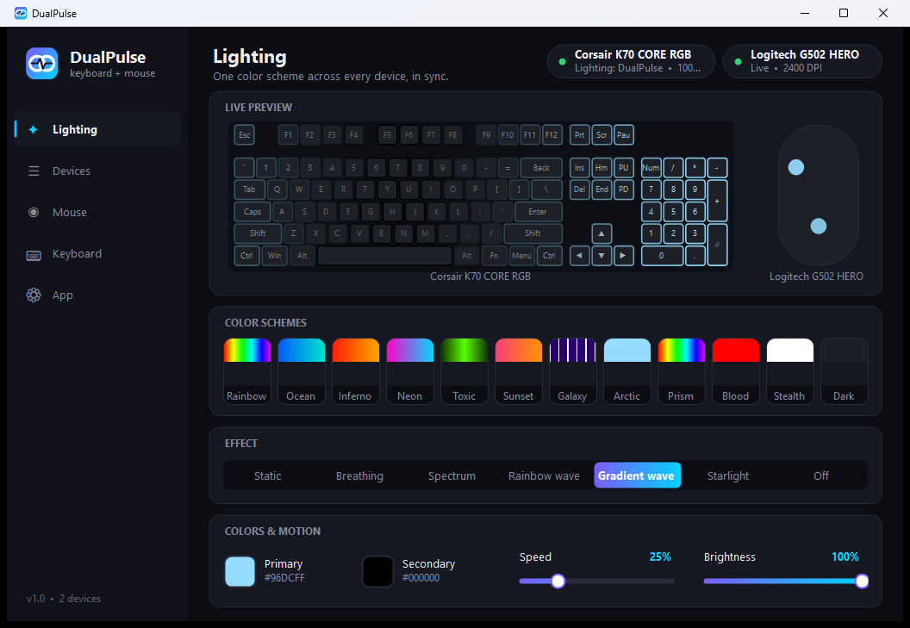
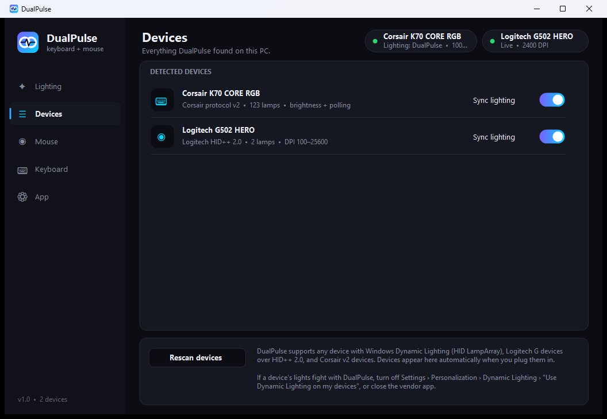
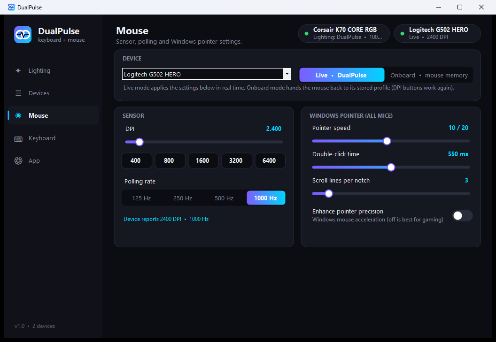

<div align="center">


# DualPulse

**One lightweight app for your keyboard and mouse.**<br/>
RGB lighting, color schemes, DPI and polling rate across brands, with no vendor bloatware.




</div>

---

## Why

Most setups end up with one vendor app for the keyboard and another for the mouse. Each runs its own
background services, and their lighting never lines up. DualPulse talks to the devices directly over USB HID
and drives every device from **one shared effect space**, so a rainbow wave flows from your keyboard into your mouse.

- **Single ~130 KB `.exe`.** No installer, no account, no telemetry.
- **No SDK needed to build.** It compiles with the C# compiler that ships with Windows.
- **Hands control back cleanly.** Exit, and every device returns to its own onboard memory.

## Features

| | |
|---|---|
| 🌈 **Synced lighting** | Static, Breathing, Spectrum, Rainbow wave, Gradient wave, Starlight and Off. One effect runs across all devices, using each LED's physical position. |
| 🎨 **Color schemes** | 12 presets (Ocean, Inferno, Neon, Galaxy, Sunset…) plus your own two colors, speed and brightness. |
| 🖱️ **Mouse** | DPI (with device range and step), DPI presets, polling rate, and live versus onboard-profile mode. |
| ⌨️ **Keyboard** | Hardware LED brightness and polling rate. |
| 🪟 **Windows settings** | Pointer speed, acceleration (enhance pointer precision), scroll lines, double-click time, key repeat delay and rate. |
| 🔌 **Hot-plug** | Devices are detected automatically when plugged in or unplugged. |
| 🧭 **Tray + autostart** | Runs quietly in the tray and reapplies your settings at login. |

<p align="center">
  
  
</p>

## Supported hardware

DualPulse picks the best driver for each device automatically:

| Driver | Works with | What you can control |
|---|---|---|
| **Windows Dynamic Lighting** (HID LampArray) | Any keyboard, mouse, headset or accessory that supports Dynamic Lighting. This includes many current Razer, Logitech, Corsair, ASUS, HyperX, SteelSeries and Microsoft devices. | Per-lamp RGB, laid out from the device's own lamp positions |
| **Logitech G** (HID++ 2.0) | Logitech G mice and keyboards, wired or via a Lightspeed receiver | RGB zones, DPI, polling rate, onboard/host mode |
| **Corsair** (protocol v2) | Current wired Corsair keyboards and mice | Brightness and polling rate on any v2 device. Per-key RGB on [known models](#adding-your-device). |
| **Windows** | Every mouse and keyboard | Pointer speed, acceleration, scroll, double-click, key repeat |

Capabilities are **discovered from the device itself**. For example, a Logitech mouse reports its own feature
table, DPI range and polling rates. Nothing is hardcoded per model except Corsair LED maps.

> **Tested on:** Corsair K70 CORE RGB and Logitech G502 HERO. Other devices that use these protocols
> should work. Please [open an issue](../../issues) with your result, good or bad.

## Install

1. Download `DualPulse.exe` from the [latest release](../../releases/latest).
2. Run it. Windows may show a SmartScreen prompt because the exe is not code-signed. Choose **More info › Run anyway**.

Requires Windows 10 or 11. .NET Framework 4.8 is already built into both.

## Build from source

```bat
git clone https://github.com/spacexbt/DualPulse.git
cd DualPulse
build.cmd
```

The output is `bin\DualPulse.exe`. The build uses `csc.exe` from .NET Framework 4.x, so you don't need Visual Studio, an SDK or any NuGet packages.

Useful switches:

| Command | Effect |
|---|---|
| `DualPulse.exe --tray` | Start minimized to the tray (used by autostart) |
| `DualPulse.exe --exit` | Ask a running instance to hand devices back and quit |

## How it works

```
src/
├─ Hid.cs                 Win32 HID access: enumeration, interrupt + feature reports, HID parser
├─ Engine.cs              device manager, hot-plug scanner, effect engine, settings
├─ Devices/
│  ├─ Device.cs           device / sensor / hardware-settings abstractions
│  ├─ LampArray.cs        Windows Dynamic Lighting (HID usage page 0x59)
│  ├─ Logitech.cs         Logitech HID++ 2.0
│  └─ Corsair.cs          Corsair protocol v2 + keyboard layouts
└─ UI/                    WinForms UI with custom-drawn dark controls
```

Every lit device gets a place in a shared layout: keyboards first, then mice, then everything else.
Each frame, the effect is evaluated at every LED's position and streamed at around 30 fps. Static colors are written
only when they change. Low-level protocol notes are in [`docs/PROTOCOLS.md`](docs/PROTOCOLS.md).

## Adding your device

**Corsair per-key lighting.** Add the PID, LED count and layout to `CorsairDriver.Models` in
[`src/Devices/Corsair.cs`](src/Devices/Corsair.cs). Brightness and polling already work for any Corsair v2 device without this.

**A new protocol.** Implement `IDriver` (probe HID collections) and a `Device` subclass (`WriteLamps`, plus optional
`ISensor` / `IHwSettings`), then add the driver to `Engine.Drivers`. Drivers run in priority order, and native drivers
take precedence over the generic Dynamic Lighting view of the same device.

Pull requests are welcome.

## Troubleshooting

| Problem | Fix |
|---|---|
| Lights flicker or fight | Another app is driving the same device. Turn off **Settings › Personalization › Dynamic Lighting › Use Dynamic Lighting on my devices**, or close iCUE / G HUB / Synapse lighting. |
| Mouse DPI buttons stopped working | The mouse is in **Live** mode. Switch to **Onboard** on the Mouse page to use the stored profile. |
| Keyboard colors look scrambled | Keyboard page › Troubleshooting › **Alternative color data format**. |
| A device isn't listed | Click **Rescan devices**. If it still doesn't show up, open an issue with the device name and its USB VID:PID. |

Settings are stored in `%APPDATA%\DualPulse\settings.ini`.

## Disclaimer

DualPulse is an independent project. It is not affiliated with or endorsed by Logitech, Corsair, Microsoft, or any other
hardware vendor. All trademarks belong to their owners. The protocol support was built for interoperability with
hardware you own. Use it at your own risk.

## License

[MIT](LICENSE)
